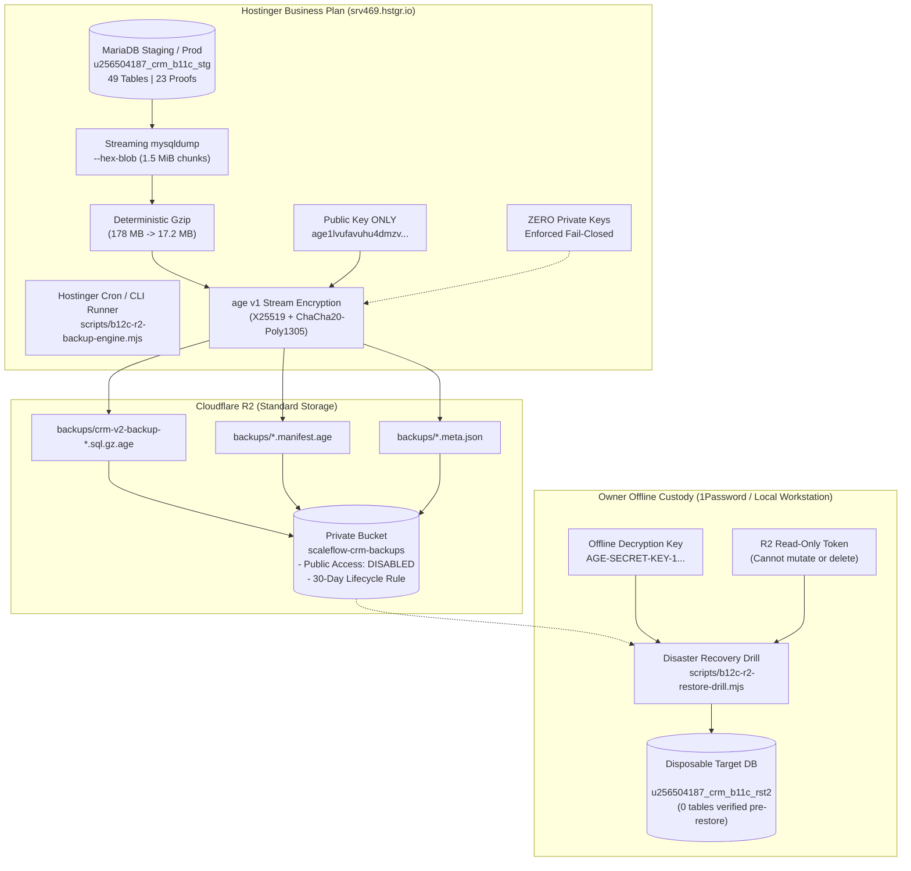

# SCALE FLOW SALES OS 3.0
## CLOUDFLARE R2 AUTOMATED ENCRYPTED BACKUP & RECOVERY RUNBOOK
### Checkpoint B12C — Standard Storage, Offline Key Custody & Disaster Recovery

---

## 1. ARCHITECTURE & SECURITY POSTURE



---

## 2. CLOUDFLARE R2 CONFIGURATION & OWNER UI INSTRUCTIONS

> [!IMPORTANT]
> Do NOT create R2 buckets or credentials until you are ready to approve off-site backup storage.
> **NEVER paste private keys, API secrets, or access keys into chat or commit them to Git.**

### Step 1: Log in to Cloudflare Dashboard
1. Go to [https://dash.cloudflare.com/](https://dash.cloudflare.com/).
2. In the left navigation menu, click **R2 Object Storage**.

### Step 2: Create Dedicated Backup Bucket
1. Click **Create bucket**.
2. **Bucket Name:** `scaleflow-crm-backups`
3. **Location:** Select **Automatic** or **APAC** (closest to India).
4. **Storage Class:** Select **Standard**.
5. Click **Create Bucket**.

### Step 3: Configure 30-Day Automatic Lifecycle Rule (Scoped to Rolling Backups)
> [!IMPORTANT]
> To prevent Cloudflare from deleting your last remaining backup if backups pause for >30 days, the lifecycle rule is strictly scoped to prefix `backups/rolling/`. The pinned baseline under `backups/pinned/` has NO lifecycle rule and will NEVER be deleted automatically.

1. Open the `scaleflow-crm-backups` bucket.
2. Click the **Settings** tab.
3. Scroll to **Lifecycle Rules** and click **Add rule**.
4. **Rule Name:** `crm-rolling-30-day-retention`
5. **Rule Scope:** Select **Limit rule by prefix or tags**.
6. **Prefix:** Enter `backups/rolling/` (DO NOT select all objects).
7. **Action:** Check **Delete objects after** and enter `30` days.
8. Click **Save**.

### Step 4: Verify Public Access is Strictly Disabled
1. In the **Settings** tab of `scaleflow-crm-backups`, locate **Public access**.
2. Verify **R2.dev subdomain** is **Disabled**.
3. Verify **Custom Domains** has **0 domains connected**.
4. The bucket is now strictly private and accessible only via signed S3 API requests.

### Step 5: Generate Scoped API Tokens
Navigate to **R2 Object Storage** (overview) -> **Manage R2 API Tokens** -> **Create API token**:

#### Token A: Backup Producer Token (For Hostinger Automated Uploads)
- **Token Name:** `crm-v2-backup-producer`
- **Permissions:** Select **Object Read & Write**.
  *(Note: Cloudflare R2 does not support a native "Put-Only" token role. Our code enforces non-destructive timestamped naming and safe retention floors).*
- **Bucket Scoping:** Select **Specific bucket** -> `scaleflow-crm-backups`.
- Click **Create API Token**.
- Save the following into your local `.env`:
  - `CLOUDFLARE_ACCOUNT_ID`
  - `R2_ACCESS_KEY_ID`
  - `R2_SECRET_ACCESS_KEY`
  - `R2_BUCKET_NAME=scaleflow-crm-backups`

#### Token B: Disaster Recovery Token (For Off-Site Restore Drill ONLY)
- **Token Name:** `crm-v2-disaster-recovery-reader`
- **Permissions:** Select **Object Read Only** (strictly read-only; cannot overwrite or delete any archives).
- **Bucket Scoping:** Select **Specific bucket** -> `scaleflow-crm-backups`.
- Click **Create API Token**.
- Save this token alongside your offline private age key.

### Step 6: Immutability, Bucket Lock & Overwrite Protection
1. **Conditional Writes (`If-None-Match: *`):**
   - The backup engine automatically sends `If-None-Match: *` with every archive upload.
   - If an archive with that key already exists, Cloudflare R2 returns `412 Precondition Failed` and rejects the write. This prevents any accidental or malicious overwrite by a compromised upload token.
2. **Cloudflare R2 Object Lock (Optional WORM):**
   - Cloudflare R2 supports S3 Object Lock in Compliance and Governance modes.
   - If enabled on the bucket, objects cannot be deleted by *anyone* (including the account owner) until their retention period expires.
   - When using Object Lock, ensure the lock period (e.g. 30 days) matches or is shorter than the lifecycle deletion rule, so locked objects are deleted only after the lock expires.
3. **Secret-Free Metadata Verification:**
   - The engine validates every `.meta.json` with `assertMetaJsonIsSecretFree` before upload.
   - Contains strictly cryptographic digests (SHA-256), byte sizes, table/row counts, format string, and public key.
   - Never exposes database credentials, passwords, hostnames, connection URLs, or customer data.

---

## 3. MONTHLY ECONOMICS & COST ESTIMATE

Cloudflare R2 provides zero egress fees and a generous permanent free tier:

| Component | Projected Monthly CRM V2 Usage | Cloudflare R2 Free Tier Allowance | Billed Usage | Estimated Cost |
| :--- | :--- | :--- | :--- | :--- |
| **Storage** | ~518 MiB (30 backups × 17.26 MiB) | 10 GB / month | 0 GB | **$0.00 / ₹0** |
| **Class A Operations** (Writes, Lists) | ~90 requests / month (1 nightly upload + list) | 1,000,000 requests / month | 0 requests | **$0.00 / ₹0** |
| **Class B Operations** (Reads, Heads) | ~120 requests / month (Verification + drills) | 10,000,000 requests / month | 0 requests | **$0.00 / ₹0** |
| **Egress Bandwidth** | ~17.26 MiB / restore drill | Unlimited / $0.00 per GB | 0 GB | **$0.00 / ₹0** |
| **TOTAL** | — | — | — | **$0.00 / ₹0 per month** |

*Even if the free tier is fully exhausted by other projects on the same Cloudflare account:*
`0.52 GB × $0.015/GB = $0.0078/month` (less than **₹1 per month**).

---

## 4. ENCRYPTION KEY CUSTODY & ZERO-KNOWLEDGE POLICY

- **Algorithm:** Standard `age-encryption.org/v1` (X25519 Curve25519 ECDH + ChaCha20-Poly1305 AEAD).
- **Public Recipient Key (`age1...`):**
  - Safe to store in Hostinger `.env` as `BACKUP_AGE_RECIPIENT_PUBKEY`.
  - Can only encrypt data; cannot decrypt or inspect backups.
- **Secret Recovery Key (`AGE-SECRET-KEY-1...`):**
  - Stored strictly **offline** in Owner custody (e.g. 1Password).
  - NEVER placed on Hostinger, Git, or staging runtimes.
  - The backup producer engine enforces `assertBackupProducerEnvHasNoPrivateKey` and throws an immediate error if any secret key is detected.

To generate a fresh keypair:
```bash
node scripts/b12c-generate-keys.mjs
```

---

## 5. AUTOMATED BACKUP EXECUTION

The backup engine orchestrates snapshot creation, compression, encryption, upload, and verification:
```bash
node scripts/b12c-r2-backup-engine.mjs
```

### Process Lifecycle:
1. **Consistency Snapshot:** Streams tables using transactional isolation and 1.5 MiB chunked statements.
2. **Deterministic Gzip:** Compresses 178 MiB raw SQL to ~17.2 MiB.
3. **age v1 Encryption:** Encrypts in 64 KiB O(1) memory streaming chunks.
4. **Manifest Creation:** Generates `.meta.json` and encrypted `.manifest.age` with SHA-256 digests.
5. **R2 Upload:** Uploads via AWS Signature V4 with SHA-256 payload integrity headers.
6. **HeadObject Verification:** Verifies byte count and ETag on Cloudflare R2 before confirming success.
7. **Retention Pruning:** Identifies archives > 30 days old. **Strict safeguard:** If total archives ≤ 1, pruning is skipped to prevent accidental total data loss.

---

## 6. OFF-SITE DISASTER RECOVERY DRILL

To perform a clean-target recovery drill using synthetic staging data:
```bash
node scripts/b12c-r2-restore-drill.mjs --confirm-clean-target
```

### Safety Rules:
- The target database MUST be disposable (e.g. `u256504187_crm_b11c_rst2`).
- Target database MUST be confirmed completely empty (`0` tables).
- Source database, CRM V1, and production names fail closed immediately.
- Reconciles 49 tables, 311+ rows, 23 payment proofs (97 BLOB chunks), and financial sums.

---

## 7. OPERATIONAL MONITORING & HEALTH RULES

The monitoring service in `src/server/backup/backupHealth.server.ts` enforces:
1. **Stale Backup Detection:** Backups older than 26 hours are marked `isStale: true` and trigger warning alerts.
2. **Verified Recovery Rule:** "A successful upload alone must not count as a verified recovery." `recoveryVerified` remains `false` until an actual restore drill has been completed and verified.
3. **Storage Consumption:** Tracks archive byte counts and reports active retention status.
