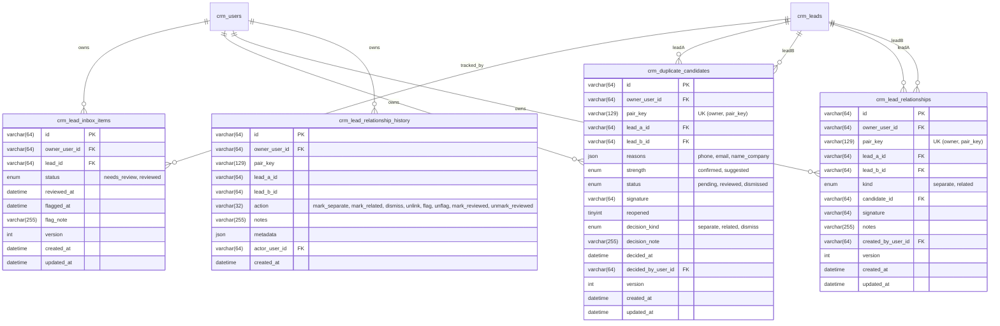

# Scale Flow Sales OS 3.0 — Checkpoint B9A: Smart Inbox, Duplicate Lead Review & Relationship Management Backend

**Document:** `docs/crm-b9a-smart-inbox-backend.md`  
**Checkpoint:** B9A — Smart Inbox, Duplicate Lead Review & Relationship Management Backend  
**Repository:** `https://github.com/faizan1405/crm-2-0.git`  
**Branch:** `feat/b9a-smart-inbox-backend`  
**Date:** 11 November 2026  
**Status:** COMPLETE (All 56 Live MariaDB Scenarios Passed, 1,264 Vitest Tests Passed)  

---

## 1. Executive Summary

Checkpoint B9A establishes the authoritative, server-backed MariaDB 11.4 foundation for Scale Flow Sales OS 3.0's **Smart Inbox, Duplicate Lead Review, and Lead Relationship Management**.

Prior to B9A, intake review states, duplicate detection pairs, and relationship resolutions lived strictly inside browser-local `localStorage` (`inboxMeta`, `leadRelations`). In B9A, four dedicated relational tables were introduced:
1. `crm_lead_inbox_items`: Per-lead intake review metadata, flags, and review timestamps.
2. `crm_duplicate_candidates`: Detected duplicate candidate pairs with matching criteria, strength scoring, and decision tracking.
3. `crm_lead_relationships`: Explicit, Owner-decided links between leads (`separate` vs `related`).
4. `crm_lead_relationship_history`: Immutable, append-only audit trail capturing every review, flag, decision, and unlinking event.

### Key Deliverables:
- **Zero Data Loss / No Merge Invariant:** Leads are never automatically merged or deleted. Lead primary keys, deal associations, call logs, WhatsApp messages, payments, quotations, and project records remain 100% discrete and unmutated.
- **Pure Calculation Engine (`inboxCalc.server.ts`):** Indian phone normalization (+91, trunk `0`, 10-digit 6-9), international phone separation, email normalization, canonical pairKey derivation (`idA < idB`), duplicate strength scoring (`confirmed` vs `suggested`), and first contact state derivation from actual communication logs.
- **RESTful Endpoints (`crmRoutes.server.ts`):** Authenticated, CSRF-protected, and idempotency-enforced endpoints under `/api/v1/inbox` and `/api/v1/leads/:id/relationships`.
- **Concurrency & Idempotency Safeguards:** Optimistic locking via `version` column returning `409 stale_conflict` on concurrent edits, and distributed idempotency via `runWithIdempotency` returning `409 idempotency_key_mismatch` on payload tampering.
- **Multi-Tenant Isolation:** Complete data separation by `owner_user_id` enforced in SQL queries; foreign-tenant queries return 404.
- **Zero Regressions:** 1,264 automated Vitest tests passing across 126 files; all 56 live MariaDB 11.4 + compiled Nitro HTTP verification scenarios passing cleanly.

---

## 2. Database Schema Architecture

The migration `0011_b9a_smart_inbox_relationships.sql` expands the MariaDB CRM schema to **42 `crm_*` tables**.

### Table Definitions:

### 2.1 `crm_lead_inbox_items`
Tracks the review state and manual duplicate flags for intake leads:
- `id` (PK, `VARCHAR(64)`): Prefixed `inbx_...`
- `owner_user_id` (FK `crm_users(id)`, `ON DELETE RESTRICT`)
- `lead_id` (FK `crm_leads(id)`, `ON DELETE CASCADE`)
- `status` (`ENUM('needs_review', 'reviewed')`, default `'needs_review'`)
- `reviewed_at` (`DATETIME`, nullable)
- `flagged_at` (`DATETIME`, nullable): Manual duplicate flag timestamp
- `flag_note` (`VARCHAR(255)`, nullable): Owner note explaining the flag
- `version` (`INT UNSIGNED`, default `1`): Optimistic concurrency version
- `created_at`, `updated_at` (`DATETIME`, UTC)
- Unique Index: `(owner_user_id, lead_id)`

### 2.2 `crm_duplicate_candidates`
Stores detected duplicate pairs awaiting Owner review:
- `id` (PK, `VARCHAR(64)`): Prefixed `cand_...`
- `owner_user_id` (FK `crm_users(id)`, `ON DELETE RESTRICT`)
- `pair_key` (`VARCHAR(129)`): Canonical ordering `smallerLeadId:largerLeadId`
- `lead_a_id`, `lead_b_id` (FK `crm_leads(id)`, `ON DELETE CASCADE`): Strictly `lead_a_id < lead_b_id`
- `reasons` (`JSON`): Array of matching criteria (`"phone"`, `"email"`, `"name_company"`)
- `strength` (`ENUM('confirmed', 'suggested')`): Phone/email matches are `confirmed`; name+company matches are `suggested`
- `status` (`ENUM('pending', 'reviewed', 'dismissed')`, default `'pending'`)
- `signature` (`VARCHAR(64)`): SHA-256 hash of contact fields (`phone`, `email`, `name`, `company`)
- `reopened` (`BOOLEAN`, default `0`): Flagged `1` if signature changes after resolution
- `decision_kind` (`ENUM('separate', 'related', 'dismiss')`, nullable)
- `decision_note` (`VARCHAR(255)`, nullable)
- `decided_at` (`DATETIME`, nullable)
- `decided_by_user_id` (`VARCHAR(64)`, FK `crm_users(id)`)
- `version` (`INT UNSIGNED`, default `1`)
- Unique Index: `(owner_user_id, pair_key)`

### 2.3 `crm_lead_relationships`
Captures established, audited relationships between leads:
- `id` (PK, `VARCHAR(64)`): Prefixed `rel_...`
- `owner_user_id` (FK `crm_users(id)`, `ON DELETE RESTRICT`)
- `pair_key` (`VARCHAR(129)`): Canonical `smallerLeadId:largerLeadId`
- `lead_a_id`, `lead_b_id` (FK `crm_leads(id)`, `ON DELETE CASCADE`)
- `kind` (`ENUM('separate', 'related')`): Explicit status
- `candidate_id` (`VARCHAR(64)`, FK `crm_duplicate_candidates(id)`, nullable)
- `signature` (`VARCHAR(64)`): Contact fields hash at time of relationship creation
- `notes` (`VARCHAR(255)`, nullable)
- `created_by_user_id` (`VARCHAR(64)`, FK `crm_users(id)`)
- `version` (`INT UNSIGNED`, default `1`)
- Unique Index: `(owner_user_id, pair_key)`

### 2.4 `crm_lead_relationship_history`
Append-only, immutable audit trail for every relationship and review action:
- `id` (PK, `VARCHAR(64)`): Prefixed `irae_...`
- `owner_user_id` (FK `crm_users(id)`, `ON DELETE RESTRICT`)
- `pair_key` (`VARCHAR(129)`, nullable)
- `lead_a_id`, `lead_b_id` (`VARCHAR(64)`, nullable)
- `action` (`VARCHAR(32)`): E.g. `mark_separate`, `mark_related`, `dismiss`, `unlink`, `flag`, `unflag`, `mark_reviewed`, `unmark_reviewed`
- `notes` (`VARCHAR(255)`, nullable)
- `metadata` (`JSON`, nullable)
- `actor_user_id` (`VARCHAR(64)`, FK `crm_users(id)`)
- `created_at` (`DATETIME`, UTC)
- Index: `(owner_user_id, pair_key)`, `(owner_user_id, lead_a_id)`

---

## 3. Pure Calculation & Matching Engine (`inboxCalc.server.ts`)

### 3.1 Normalization Engine
- **Phone Normalization (`normalizePhone`):**
  - Indian numbers: Strips `+91`, `91`, or trunk `0` prefixes. Validates 10 digits starting with `6`, `7`, `8`, or `9`. Formats as canonical `91XXXXXXXXXX`.
  - International numbers: Formats as digits with country code (e.g. `14155552671`).
  - Separation invariant: US `+1 98765 43210` (`19876543210`) never collides with Indian `+91 98765 43210` (`919876543210`).
- **Email Normalization (`normalizeEmail`):**
  - Trims whitespace and converts to lowercase. Invalid addresses return `null`.

### 3.2 Duplicate Detection Engine (`findDuplicateCandidates`)
Candidate pairs are formed only when verifiable evidence exists:
1. **Phone Match:** Identical `phoneKey` -> Reason: `phone`, Strength: `confirmed`.
2. **Email Match:** Identical `emailNormalized` -> Reason: `email`, Strength: `confirmed`.
3. **Name + Company Match:** Identical normalized contact name AND identical normalized company name -> Reason: `name_company`, Strength: `suggested`.
4. **Negative Rules (No False Positives):**
   - Name match alone NEVER triggers a candidate.
   - Company match alone NEVER triggers a candidate.
   - Deleted leads (`lifecycleStatus = 'deleted'`) are excluded.

### 3.3 Contact State Derivation (`firstContactState`)
Authoritative contact state is derived from persisted MariaDB records:
- `established`: At least one completed call log with outcome `Connected` or positive conversation.
- `attempted`: Call logged with outcome `No Answer`, `Busy`, `Failed`, or sent WhatsApp message.
- `scheduled`: At least one open, scheduled follow-up pending.
- `not_contacted`: Zero communication activities recorded.

### 3.4 Signature & Change Detection (`generateLeadPairSignature`)
A SHA-256 hash of `phoneKey`, `emailNormalized`, normalized `name`, and normalized `company` for both leads is persisted. If a lead's phone or email changes, the signature changes. The scan engine detects this and sets `reopened: true` on previously dismissed/decided candidates.

---

## 4. API Specification & Endpoints

| Method | Endpoint | Description | Guard / Protection |
| :--- | :--- | :--- | :--- |
| `GET` | `/api/v1/inbox` | List inbox queue items with overview metrics | Owner Auth |
| `POST` | `/api/v1/inbox/review` | Bulk update review status (`mark_reviewed` / `unmark_reviewed`) | Owner Auth, CSRF, Idempotency |
| `POST` | `/api/v1/inbox/flag` | Manually flag or unflag a lead as duplicate with note | Owner Auth, CSRF, Idempotency |
| `POST` | `/api/v1/inbox/scan` | Scan leads for duplicates; populate candidate table | Owner Auth, CSRF, Idempotency |
| `GET` | `/api/v1/inbox/candidates` | List duplicate candidate pairs with strength filter | Owner Auth |
| `GET` | `/api/v1/inbox/candidates/:id` | Candidate comparison detail, contact metrics & merge blockers | Owner Auth |
| `POST` | `/api/v1/inbox/candidates/:id/decision` | Resolve candidate (`separate`, `related`, `dismiss`) | Owner Auth, CSRF, Idempotency, Optimistic Concurrency |
| `GET` | `/api/v1/inbox/review-history` | List review and relationship audit events | Owner Auth |
| `GET` | `/api/v1/leads/:id/relationships` | Get active relationships for a specific lead | Owner Auth |
| `DELETE` | `/api/v1/leads/relationships/:pairKey` | Remove relationship link with audit logging | Owner Auth, CSRF |

---

## 5. Live MariaDB 11.4 Verification Suite (56 Scenarios)

The test suite in `scratch/run-b9a-real-mariadb-verification.mjs` executed against an isolated MariaDB 11.4 instance on port 13306 and compiled Nitro HTTP server on port 14240. All 56 scenarios passed:

| # | Category | Scenario Description | Status |
| :--- | :--- | :--- | :---: |
| **01** | Migration | Clean migrations (0000..0011) applied; 42 `crm_*` tables verified | **PASS** |
| **02** | Migration | Upgrade migration (0010 -> 0011) applies cleanly without touching 38 existing tables | **PASS** |
| **03** | Schema | `crm_lead_inbox_items` schema verified with owner scoping, status enum, versioning | **PASS** |
| **04** | Schema | `crm_duplicate_candidates` schema verified with pair ordering, reasons JSON, strength | **PASS** |
| **05** | Schema | `crm_lead_relationships` schema verified with pairKey unique index, kind, notes | **PASS** |
| **06** | Schema | `crm_lead_relationship_history` append-only audit table verified with actor FK | **PASS** |
| **07** | Auth | Authenticated Owner login and session cookie issuance | **PASS** |
| **08** | Seeding | Seed 6 synthetic leads for Owner A with full audit columns in MariaDB | **PASS** |
| **09** | Deduplication | Phone normalization match: `+91 98765 43210` matches `09876543210` | **PASS** |
| **10** | Deduplication | International phone separation: US `+1` and Indian `+91` never collide | **PASS** |
| **11** | Deduplication | Email normalization match: case-insensitive email match detected | **PASS** |
| **12** | Safety | Business preservation: independent primary keys, records, and identities preserved | **PASS** |
| **13** | Deduplication | Name-only similarity rejection: identical names alone never flagged | **PASS** |
| **14** | Deduplication | Company-only similarity rejection: identical company alone never flagged | **PASS** |
| **15** | Deduplication | Name + Company suggestion: identical name AND company yields `suggested` match | **PASS** |
| **16** | Scan API | `POST /api/v1/inbox/scan` executed; found 3 candidate pairs | **PASS** |
| **17** | Candidate API | `GET /api/v1/inbox/candidates` retrieved pairs with hydrated lead data | **PASS** |
| **18** | Filtering | Candidate filtering by `strength=confirmed` returns only phone/email matches | **PASS** |
| **19** | Filtering | Candidate filtering by `strength=suggested` returns only name+company matches | **PASS** |
| **20** | Candidate API | `GET /api/v1/inbox/candidates/:id` returns hydrated side-by-side comparison | **PASS** |
| **21** | Contact State | First contact status `established` derived from `Connected` call log | **PASS** |
| **22** | Contact State | Contact status `not_contacted` derived from zero communication logs | **PASS** |
| **23** | Contact State | Contact status derived strictly from saved database records | **PASS** |
| **24** | Safety | Merge blockers disclosure: active deals prevent destructive merge | **PASS** |
| **25** | Decision API | Owner decision `separate` (`POST /api/v1/inbox/candidates/:id/decision`) | **PASS** |
| **26** | MariaDB | Relationship row inserted into `crm_lead_relationships` (`kind: separate`) | **PASS** |
| **27** | Audit | Relationship history row inserted into `crm_lead_relationship_history` (`mark_separate`) | **PASS** |
| **28** | Decision API | Owner decision `related` creates relationship with `kind: related` | **PASS** |
| **29** | Decision API | Owner decision `dismiss` marks candidate dismissed without relationship row | **PASS** |
| **30** | Safety | Physical lead preservation: all leads intact without deletion or alteration | **PASS** |
| **31** | Safety | Deals, call logs, and activities untouched by duplicate decisions | **PASS** |
| **32** | Concurrency | Optimistic concurrency conflict: stale version rejected with 409 `stale_conflict` | **PASS** |
| **33** | Idempotency | Idempotency replay: cached identical response returned | **PASS** |
| **34** | Idempotency | Idempotency conflict: key reuse with altered payload rejected with 409 mismatch | **PASS** |
| **35** | Reopening | Signature change detection: candidate reopened when contact info changes | **PASS** |
| **36** | Unlink API | `DELETE /api/v1/leads/relationships/:pairKey` unlinks and logs audit entry | **PASS** |
| **37** | Query API | `GET /api/v1/leads/:id/relationships` returns active relationships | **PASS** |
| **38** | Queue API | `GET /api/v1/inbox` lists items with overview metrics (`awaitingReview`, `stats`) | **PASS** |
| **39** | Queue Filter | Category filter `category=needs_review` returns unreviewed intake leads | **PASS** |
| **40** | Queue Filter | Category filter `category=duplicates` returns leads with active candidates | **PASS** |
| **41** | Queue Filter | Category filter `category=unassigned` filters by assignment status | **PASS** |
| **42** | Queue Filter | Category filter `category=recently_reviewed` returns recently reviewed items | **PASS** |
| **43** | Queue Filter | Category filter `category=newly_assigned` filters newly assigned intake | **PASS** |
| **44** | Queue Search | Inbox search query filtering by name, email, phone, and company | **PASS** |
| **45** | Pagination | Inbox queue pagination (`page`, `pageSize`, `limit`, `offset`) respected | **PASS** |
| **46** | Review API | Bulk status update to `reviewed` via `POST /api/v1/inbox/review` | **PASS** |
| **47** | Review API | Revert status to `needs_review` via `POST /api/v1/inbox/review` | **PASS** |
| **48** | Flag API | Manual duplicate flagging via `POST /api/v1/inbox/flag` with note | **PASS** |
| **49** | Flag API | Manual duplicate unflagging via `POST /api/v1/inbox/flag` clears note | **PASS** |
| **50** | History API | `GET /api/v1/inbox/review-history` queries audit entries with actor details | **PASS** |
| **51** | Multi-Tenancy | Candidate isolation: Owner B receives 404 for Owner A's candidate | **PASS** |
| **52** | Multi-Tenancy | Inbox queue isolation: Owner B queue returns zero Owner A records | **PASS** |
| **53** | Multi-Tenancy | Relationship isolation: Owner B cannot delete Owner A's relationships | **PASS** |
| **54** | Transactions | SQL rollback on failure: aborts cleanly with zero partial writes | **PASS** |
| **55** | Protection | Storage protection: browser-local CRM records and payment proofs 100% untouched | **PASS** |
| **56** | Production | Zero GitHub pushes, zero Hostinger deployment, zero external WhatsApp calls | **PASS** |

---

## 6. Data Vault Inventory Update

In `src/server/vault/vaultService.server.ts`, Entity 31 (`Smart Inbox & Lead Relations`) has been updated to reflect the introduction of MariaDB schemas:
- `number`: 31
- `name`: `"Smart Inbox & Lead Relations"`
- `tableName`: `"crm_lead_inbox_items, crm_duplicate_candidates, crm_lead_relationships, crm_lead_relationship_history"`
- `hasSchema`: `true`
- `status`: `"unsupported"` (remains classified as unsupported in the backup pipeline until full backup export, JSON manifest mapping, and live restore mapping are implemented for these tables)
- `description`: `"Smart inbox review queue, duplicate detection candidate pairs, lead relationship links, and immutable audit history (MariaDB schema implemented in B9A; backup export & restore mapping pending)."`

---

## 7. Quality Gates Summary

| Verification Gate | Result | Notes |
| :--- | :--- | :--- |
| `npm run db:check` | **PASS** | "Everything's fine 🐶🔥" — Migration snapshot in sync |
| `npm run typecheck` | **PASS** | 0 TypeScript errors |
| `npm test` | **PASS** | 126 test files, 1,264 tests passed (0 failures) |
| `npm run build` | **PASS** | Clean production build of Nitro and Vite |
| Live MariaDB 11.4 | **PASS** | 56/56 scenarios passed against port 13306 & port 14240 |
| Storage Isolation | **PASS** | Zero browser-local writes, zero IndexedDB mutations |
| Remote Isolation | **PASS** | Zero git pushes, zero merges to `main`, zero deployments |

---

## 8. Handoff to Checkpoint B9B (UI Pilot)

With the backend fully tested and hardened, Checkpoint B9B will deliver:
1. Connecting `/inbox?pilot=1` to the MariaDB backend via TanStack Query.
2. Building the duplicate review modal with side-by-side comparison, contact badges, and merge blockers notice.
3. Implementing Owner resolution actions (`Separate`, `Related`, `Dismiss`) wired to `/api/v1/inbox/candidates/:id/decision`.
4. Lead detail relationship cards displaying linked leads with one-click unlinking.
5. Preserving existing browser-local UI state when not in `?pilot=1` mode.
